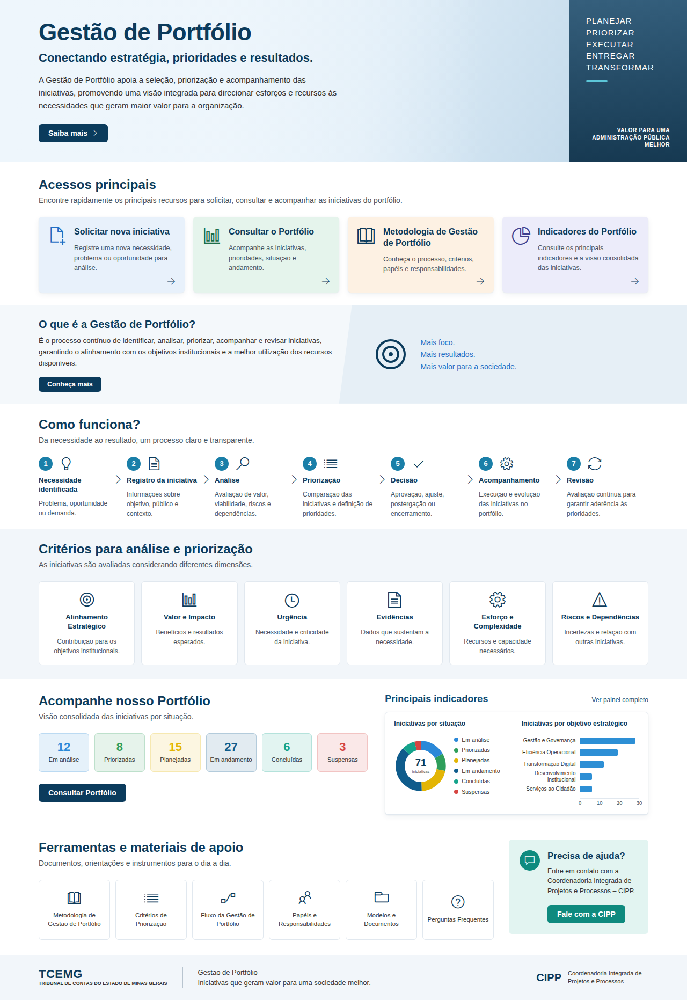
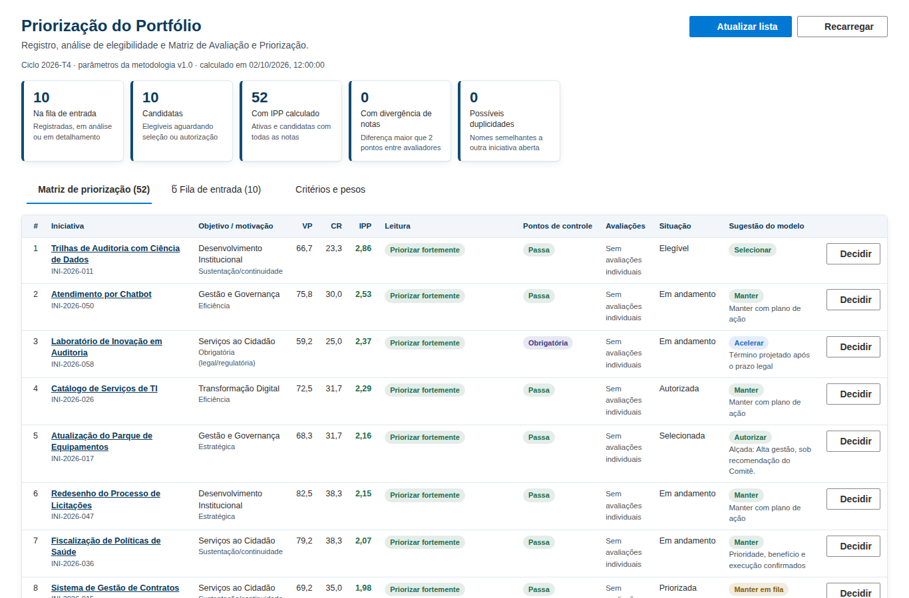
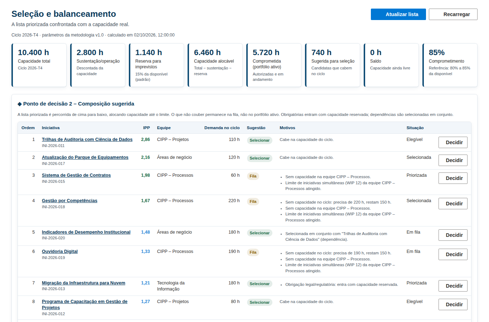
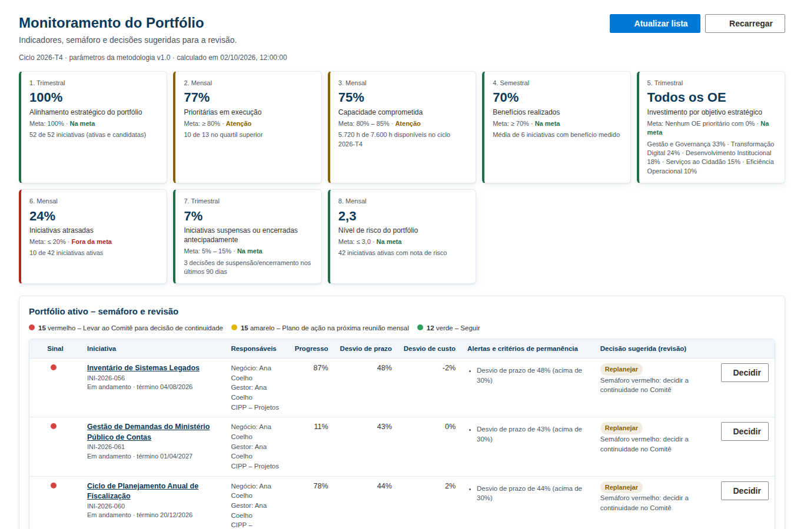
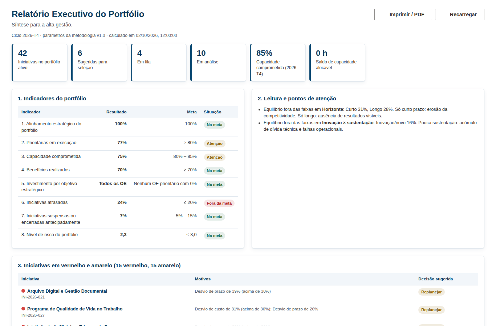

# Gestão de Portfólio – SharePoint (CIPP / TCEMG)

Implementação no SharePoint Online da página **Gestão de Portfólio** da Coordenadoria Integrada de
Projetos e Processos (CIPP) e **automação da Metodologia de Gestão de Portfólio**: registro e análise de
iniciativas, pontuação (VP, CR e IPP), seleção pela capacidade, balanceamento, monitoramento com
semáforo, os 8 indicadores, decisões registradas e relatório executivo.

A correspondência entre cada seção da metodologia e a implementação, a rotina de operação e o ajuste
anual dos pesos estão em [`docs/metodologia-automatizada.md`](docs/metodologia-automatizada.md).

O layout tem elementos que as web parts nativas não reproduzem (cards coloridos, fluxo numerado,
indicadores e gráficos). Por isso a página é montada com **web parts SPFx próprias**, uma por faixa do
layout, e um **script PnP.PowerShell** que configura o site e monta a página.



> A prévia acima foi gerada localmente com dados de exemplo e sem as fotos (o banner e a faixa
> "O que é" usam a imagem configurada; sem imagem, aparece um degradê).

## Estrutura

```
spfx/                              Solução SharePoint Framework 1.23 (React + TypeScript)
  src/methodology/                 Motor de regras da metodologia (funções puras + testes)
  src/webparts/                    Uma web part por faixa do layout + 4 web parts operacionais
  src/common/                      Estilos, componentes e base compartilhados
  src/common/portfolio/            Leitura/gravação das listas, painel de decisão, componentes comuns
provisioning/
  Deploy-GestaoPortfolio.ps1       Publica o pacote, aplica tema, navegação, listas e monta as páginas
  gestao-portfolio.config.json     Conteúdo da implantação (navegação, listas, colunas, exibições, páginas)
  metodologia.json                 Parâmetros da metodologia (pesos, faixas, limites, metas, objetivos)
  lib/GestaoPortfolio.psm1         Geração de colunas, fórmulas VP/CR/IPP, exibições e dados de exemplo
  tests/                           Testes do provisionamento (sem acesso ao SharePoint)
  theme/cipp-theme.json            Paleta de cores do site (azul-marinho do layout)
  assets/                          Imagens opcionais e o documento da metodologia
docs/                              Prévias e documentação da automação da metodologia
```

## Faixas do layout → web parts

Todas aparecem na caixa de ferramentas do editor de páginas no grupo **CIPP – Gestão de Portfólio**
e ficam em seções de **largura total**.

| Faixa do layout                         | Web part                              | Conteúdo editável no painel de propriedades |
| --------------------------------------- | ------------------------------------- | ------------------------------------------- |
| Banner "Gestão de Portfólio"            | Portfólio: Banner principal           | Título, subtítulo, texto, botão, imagem, palavras do painel lateral |
| Acessos principais                      | Portfólio: Acessos principais         | Cards (título, descrição, ícone, link, cor) |
| O que é a Gestão de Portfólio?          | Portfólio: O que é                    | Texto, botão, destaques, ícone, imagem |
| Como funciona?                          | Portfólio: Como funciona              | Etapas (título, descrição, ícone); numeração automática |
| Critérios para análise e priorização    | Portfólio: Critérios de priorização   | Critérios (título, descrição, ícone) |
| Acompanhe nosso Portfólio + Principais indicadores | Portfólio: Painel de indicadores | Textos, links, lista de origem, situações e cores |
| Ferramentas e materiais de apoio + Precisa de ajuda? | Portfólio: Ferramentas e ajuda | Atalhos (título, ícone, link) e quadro de contato |
| Rodapé TCEMG / CIPP                     | Portfólio: Rodapé institucional       | Logotipo, nomes e lema |

### Web parts operacionais da metodologia

Cada uma fica em uma página própria criada pelo script (menu **Gestão de Portfólio**):

| Página | Web part | Conteúdo |
| ------ | -------- | -------- |
| Priorizacao-do-Portfolio | Portfólio: Priorização | Fila de entrada (critérios de entrada, pontos de controle, duplicidade), Matriz de priorização (notas, VP, CR, IPP, leitura, avaliações do comitê) e critérios/pesos vigentes |
| Selecao-e-Balanceamento | Portfólio: Seleção e balanceamento | Capacidade do ciclo, composição sugerida (◆2), capacidade e WIP por equipe, faixas de equilíbrio, mapa de calor por objetivo e matriz Valor × Custo-Risco |
| Monitoramento-do-Portfolio | Portfólio: Monitoramento e indicadores | 8 indicadores com metas, leitura combinada, semáforo do portfólio ativo, gatilhos de permanência e decisão sugerida para a revisão (◆4) |
| Relatorio-Executivo-do-Portfolio | Portfólio: Relatório executivo | Síntese para a alta gestão com indicadores, alertas, roadmap por trimestre e decisões do período (imprimir/PDF) |

Em todas, o botão **Decidir** abre o painel **Registrar decisão** (◆1 Elegibilidade, ◆2 Composição,
◆3 Autorização, ◆4 Revisão e Encerramento), que grava a decisão no **Registro de Decisões** e atualiza a
situação da iniciativa. **Atualizar lista** grava na lista os campos calculados pelo modelo.

| Priorização | Seleção e balanceamento |
| --- | --- |
|  |  |
| **Monitoramento e indicadores** | **Relatório executivo** |
|  |  |

> Prévias geradas localmente com os dados de exemplo de `-SeedSampleData`.

A barra superior (busca, notificações, avatar) e o menu (Início, Sobre a CIPP, Projetos, Processos,
Gestão de Portfólio, Conhecimento) são os elementos **nativos** do SharePoint, configurados pelo script:
tema com o azul do layout, cabeçalho padrão, megamenu e itens de navegação.

### Listas criadas pelo script

| Lista | Papel na metodologia | Destaques |
| ----- | -------------------- | --------- |
| **Iniciativas** | Inventário do Portfólio e Ficha Resumida da Iniciativa | Situação (16 etapas do ciclo de vida), categorização, estimativas, pontos de controle, riscos e dependências, uma coluna de nota (1 a 5) por critério, **VP**, **CR** e **IPP** calculados pelo SharePoint, acompanhamento (linha de base, projeções, progresso, benefício) e campos gravados pelo modelo (código, ranking, semáforo, alertas, sugestão, alçada). Formulário em seções e exibições *Fila de entrada*, *Matriz de priorização*, *Portfólio ativo* e *Encerradas e retiradas* |
| **Registro de Decisões** | Memória decisória (8.4) | Iniciativa, ponto de decisão, decisão, justificativa, instância, data, situação anterior e nova |
| **Mapa de Capacidade** | Capacidade por equipe e ciclo | Ciclo (AAAA-Tn), equipe, capacidade total, sustentação, reserva (%) e limite de WIP |
| **Pontuações do Comitê** | Pontuação colegiada (opcional) | Notas de cada avaliador; divergências acima de 2 pontos são apontadas |

As colunas de notas, os objetivos estratégicos, as equipes e as categorias vêm de
`provisioning/metodologia.json`. O **Painel de indicadores** da página principal continua lendo
Situação e Objetivo estratégico da lista Iniciativas; cada indicador pode agrupar várias situações
(valores separados por `;` no painel de propriedades).

## Implantação

### Pré-requisitos

- **Node.js 22** (22.14 ou superior) para gerar o pacote.
- **PowerShell 7.4+** e **PnP.PowerShell 3.x**: `Install-Module PnP.PowerShell -Scope CurrentUser`.
- Um aplicativo Entra ID para o PnP.PowerShell (uma vez por tenant):
  `Register-PnPEntraIDAppForInteractiveLogin -ApplicationName "PnP PowerShell" -Tenant contoso.onmicrosoft.com`.
- Um **site de comunicação** (seções de largura total só existem nesse tipo de site).
- Permissões: administrador do catálogo de aplicativos (publicar o pacote), administrador do
  SharePoint (registrar o tema no tenant) e proprietário do site. Sem essas permissões, veja
  `-SkipApp` e `-SkipTheme` abaixo.

### 1. Gerar o pacote SPFx

```bash
cd spfx
npm ci
npm run build        # gera spfx/sharepoint/solution/cipp-portfolio.sppkg
```

### 2. Imagens (opcional)

Coloque em `provisioning/assets/` as imagens descritas em
[`provisioning/assets/LEIA-ME.md`](provisioning/assets/LEIA-ME.md) (banner, foto da sede, logotipos).

### 3. Revisar a configuração

Em `provisioning/gestao-portfolio.config.json`, ajuste principalmente:

- `navigation.nodes`: os links de "Sobre a CIPP", "Projetos", "Processos" e "Conhecimento" apontam para
  a página inicial do site até que as páginas de destino existam;
- `page.sections[].properties`: links dos cards e botões (os itens sem `url` aparecem sem seta);
- `page.setAsHomePage`: `true` para tornar a página a inicial do site.

### 4. Executar o script

```powershell
cd provisioning
./Deploy-GestaoPortfolio.ps1 -SiteUrl https://contoso.sharepoint.com/sites/cipp -ClientId <id-do-aplicativo>
```

Opções úteis:

| Parâmetro              | Efeito |
| ---------------------- | ------ |
| `-SeedSampleData`      | Insere 71 iniciativas de exemplo em todas as situações, com notas, estimativas, capacidade por equipe e decisões, para demonstrar as páginas |
| `-AppCatalogScope Site`| Usa o catálogo de aplicativos do próprio site em vez do catálogo do tenant |
| `-SkipApp`             | Não publica o pacote (já publicado pelo administrador) |
| `-SkipTheme`           | Não registra/aplica o tema (exige administrador do SharePoint) |
| `-SkipNavigation`, `-SkipList`, `-SkipPage` | Pulam as respectivas etapas (`-SkipList` também não publica `metodologia.json`) |
| `-MethodologyPath`     | Usa outro arquivo de parâmetros da metodologia |

O script pode ser executado novamente: as páginas são limpas e remontadas a partir da configuração, e
as listas e colunas existentes são preservadas (opções de escolha que faltarem são acrescentadas e as
fórmulas de VP, CR e IPP são atualizadas com os pesos vigentes). **Edições feitas nas páginas pelo
navegador são substituídas** a cada execução sem `-SkipPage`.

Depois de implantar, cadastre a capacidade das equipes do trimestre na lista **Mapa de Capacidade** —
sem ela, a seleção não tem com o que confrontar a lista priorizada.

### 5. Editar o conteúdo

Depois de implantada, a página é editada normalmente no SharePoint: **Editar** → selecionar a web
part → ícone de lápis. Textos, cards, etapas, critérios, ferramentas, links e imagens ficam no painel
de propriedades; listas de itens abrem um editor com adicionar, remover e reordenar. Os ícones usam os
nomes do Fluent UI (seletor disponível no editor de itens).

Também é possível montar a página manualmente: crie uma página, adicione oito seções de largura total
e insira as web parts do grupo **CIPP – Gestão de Portfólio** na ordem da tabela acima.

## Desenvolvimento

```bash
cd spfx
npm start            # servidor local; abra https://<tenant>.sharepoint.com/_layouts/workbench.aspx
npm run build        # build de produção + lint + testes + pacote
npx heft test        # apenas build + testes do motor de regras
```

```powershell
pwsh ./provisioning/tests/GestaoPortfolio.Tests.ps1   # testes do provisionamento (fórmulas, colunas, dados de exemplo)
```

As regras da metodologia ficam em `spfx/src/methodology` como funções puras (sem SharePoint):
`scoring.ts` (VP, CR, IPP, pontos de controle, critérios de entrada, alçadas, duplicidade, divergências),
`selection.ts` (capacidade, ordenação e seleção), `balance.ts` (faixas de equilíbrio), `monitoring.ts`
(desvios, semáforo, permanência, revisão), `workflow.ts` (pontos de decisão) e `evaluate.ts`
(avaliação completa e os 8 indicadores). Os testes também verificam que os padrões do código são iguais a
`metodologia.json` e que as situações, decisões e colunas usadas pelas web parts existem na configuração
de implantação.

As web parts compartilham `src/common/BaseSectionWebPart.ts`, que preenche as propriedades ausentes
com o conteúdo padrão do layout (definido no getter `defaultProperties` de cada web part). Assim cada
web part já aparece completa ao ser adicionada e o script só precisa informar o que muda (links e
imagens).
